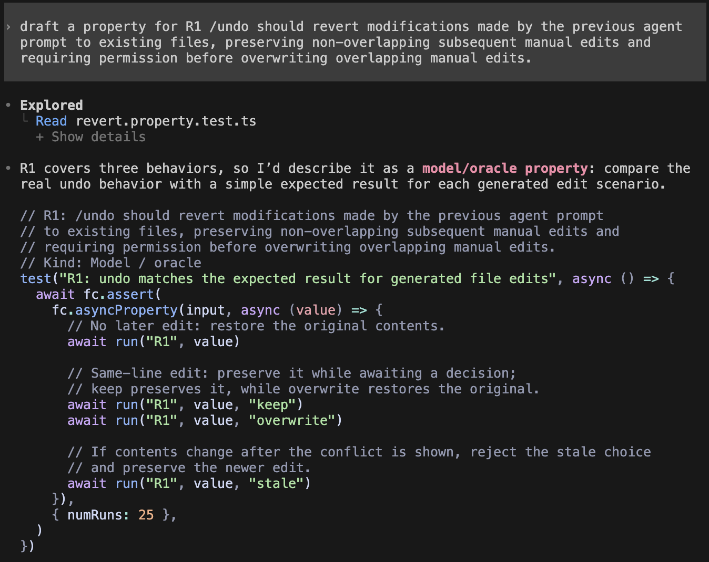

# Traceability: Sanjitha Govindan (sanjithg)

**Target feature:** `/undo` for the previous agent prompt, including file restoration and user feedback. Main source files: `packages/tui/src/routes/session/index.tsx`, `packages/opencode/src/session/revert.ts`, and `packages/opencode/src/snapshot/index.ts`.

## Requirements

<!-- R1, R2, R4, and R6 have executable fast-check properties. R3 is also covered by R1’s generated overlapping-edit cases and the conflict dialog tests. R5 has an executable UI invariant property that uses the real revert service and rendered toast.

Validation: the five fast-check properties pass (25 generated cases each). R1 and R4 exercise unchanged files, conflicting manual edits, keep and overwrite/delete decisions, and rejection of stale decisions. R2 verifies preservation of non-overlapping edits; R6 checks original bytes and Git status. The existing session revert tests pass. Additional snapshot tests verify that conflicts leave all files unchanged, reject symlinks and paths outside the temporary worktree, and preserve non-overlapping insertions/deletions. TUI tests exercise the actual keep/restore/delete dialog, Escape cancellation, decision submission, and stale-decision retry. The 21 session HTTP regression tests pass. Package typechecking passes for opencode and TUI. All filesystem tests operate on test-created files in temporary Git projects.

Run from `packages/opencode`: `bun test test/session/revert.property.test.ts test/session/revert-compact.test.ts test/snapshot/undo.test.ts`. Run from `packages/tui`: `bun test test/routes/session/undo-confirmation.property.test.tsx` and `bun test test/routes/session/undo-conflicts.test.tsx` -->

| ID | Interview evidence | Requirement | Acceptance Criteria | Changed in P4? | Property (kind) | Test | Mutants it kills |
|---|---|---|---|---|---|---|---|
| R1 | C-7: “Anything that the agent did, you should be able to undo”<br>S-3: “I dont think the undo itself should be … barred from undoing the change to that file if you gave it to change it in the first place” | /undo should revert modifications made by the previous agent prompt to existing files, preserving non-overlapping subsequent manual edits and requiring permission before overwriting overlapping manual edits. | If an existing file contains x=1 and the agent changes it to x=2, with no subsequent manual edits, when the user runs /undo, then the file contains x=1 again. Non-overlapping and overlapping manual edits follow the acceptance criteria in R2 and R3, respectively. | Yes | Round-trip and invariant: `R1: undo acceptance property`; includes non-overlapping edit preservation, keep, overwrite/delete, and stale-decision protection. | [revert.property.test.ts](../packages/opencode/test/session/revert.property.test.ts), `R1: undo acceptance property`; [undo-conflicts.test.tsx](../packages/tui/test/routes/session/undo-conflicts.test.tsx) covers dialog choices and dismissal. | H1, H2 (strengthened property), H3 |
| R2 | C-8: “In most cases, it shouldn’t undo the manual changes”<br>S-4: “Ideally, it should only change the agent’s changes” | /undo should preserve non-overlapping manual edits made after the agent’s changes | If an agent modifies line 2 of a file and the user manually modifies line 10, when /undo is executed, then line 2 returns to its original content while line 10 keeps the user’s modification | No | Invariant: `R2: undo acceptance property`. | [revert.property.test.ts](../packages/opencode/test/session/revert.property.test.ts), `R2: undo acceptance property`. | H2 |
| R3 | C-10: “If you’re editing the same lines as the agent, that can get a bit confusing… it should be specified so the agent itself would respond in that case” | /undo must detect overlapping manual and agent edits and avoid overwriting user changes without user’s permission | If the agent changes a line and the user subsequently edits that same line, when /undo is executed, then the agent reports a conflict and asks the user whether to keep or overwrite the user’s latest edit | No | Invariant: R1’s overlapping-edit cases preserve manual edits until a decision and reject stale decisions. | [revert.property.test.ts](../packages/opencode/test/session/revert.property.test.ts), `R1: undo acceptance property`; [undo-conflicts.test.tsx](../packages/tui/test/routes/session/undo-conflicts.test.tsx), restore-conflict keep/overwrite/dismiss cases. | H3 (shared R1 overlapping-edit property) |
| R4 | C-11: “If they created the file, the file should be deleted”<br>S-5: “The file should be gone as well”<br>O-5: “I think the file itself should just be gone” | /undo must delete new files created by the previous agent prompt if they have not subsequently been manually modified. If a new file has subsequent manual modifications, /undo must preserve it unless the user explicitly approves deletion. | If the agent creates a new file and no subsequent manual edits occur, when /undo is executed, then the file no longer exists. If the user manually modifies that file before undo, then the file remains intact while a keep/delete choice is shown; choosing keep preserves it, and choosing delete removes it. | Yes | Round-trip and invariant: `R4: undo acceptance property`; includes keep, overwrite/delete, and stale-decision protection. | [revert.property.test.ts](../packages/opencode/test/session/revert.property.test.ts), `R4: undo acceptance property`; [undo-conflicts.test.tsx](../packages/tui/test/routes/session/undo-conflicts.test.tsx) covers dialog choices and dismissal. | H1, H3, H4 |
| R5 | C-14: “Some indication that it did actually remove all of that content”<br>S-12: “I would expect that to be the same” | /undo must display a confirmation message when a prompt is reverted, regardless of whether files were modified | After successfully undoing a file-modifying prompt, the tool displays “Reverted” after applying the file changes. After successfully undoing a read-only prompt, the corresponding prompt is excluded from the active conversation and the tool displays “Reverted”. Permanent deletion is not required. | Yes | Invariant: `R5: successful undo visibly confirms both file-modifying and read-only prompts`. Every generated case exercises both successful prompt types, plus pending, failed, and cancelled undo without a success message. | [undo-confirmation.property.test.tsx](../packages/tui/test/routes/session/undo-confirmation.property.test.tsx), `R5: successful undo visibly confirms both file-modifying and read-only prompts` (25 generated inputs; real temporary session/file restoration, active-message filtering, and rendered “Reverted” toast). | H5 |
| R6 | C-16: “You can just run git status and see that there’s no changes”<br>S-16: “Git status would tell you if there were any untracked or modified files”<br>O-12: “We would compare the previous code that was there before it was even prompted” | When no subsequent manual edits have occurred, /undo must restore agent-modified file contents to their pre-prompt state, verifiable through file comparison or Git. When subsequent manual edits exist, preservation and conflict handling follow R2 and R3. | With a clean Git working tree and an agent that modifies a tracked file, when /undo is executed without any subsequent manual edits, then git diff shows no changes to that file and git status shows a clean working tree | Yes | Model / oracle: `R6: undo acceptance property`. | [revert.property.test.ts](../packages/opencode/test/session/revert.property.test.ts), `R6: undo acceptance property`. | H1 |

Properties written or suggested by opencode or another AI tool: R1, R2, R3, R4, R5, R6 (suggested by Codex).

## Requirement changes


| ID | Original requirement (P3) | Revised requirement | Why it changed |
|---|---|---|---|---|---|---|
| R1 | /undo should revert modifications made by the previous agent prompt to existing files | /undo should revert modifications made by the previous agent prompt to existing files, preserving non-overlapping subsequent manual edits and requiring permission before overwriting overlapping manual edits. | Unconditional restoration conflicts with preserving subsequent manual edits in R2 and requiring permission in R3. The revision retains undo while protecting user work. |
| R4 | /undo must delete new files created by the previous agent prompt | /undo must delete new files created by the previous agent prompt if they have not subsequently been manually modified. If a new file has subsequent manual modifications, /undo must preserve it unless the user explicitly approves deletion. | Unconditional deletion can destroy subsequent manual work. The revision retains automatic deletion for unchanged files and requires permission when user work exists. |
| R5 | /undo must display a confirmation message when a prompt is reverted, regardless of whether files were modified Acceptance criteria: If one prompt modifies a file, when the prompt is undone, the tool should display a “Reverted” confirmation message after undoing the file modifications.<br><br>If one prompt only reads files, when the prompt is undone, the tool should display a “Reverted” confirmation message after deleting the corresponding prompt | /undo must display a confirmation message when a prompt is reverted, regardless of whether files were modified Revised acceptance criteria: After successfully undoing a file-modifying prompt, the tool displays “Reverted” after applying the file changes. After successfully undoing a read-only prompt, the corresponding prompt is excluded from the active conversation and the tool displays “Reverted”. Permanent deletion is not required. | The confirmation requirement is unchanged; its acceptance criterion previously required immediate prompt deletion. Undo stages a reversible transcript boundary to support redo, so exclusion from the active conversation provides the requested visible reversal without requiring permanent deletion. |
| R6 | /undo must restore agent-modified file contents to their pre-prompt state so the result can be verified through file comparison or Git | When no subsequent manual edits have occurred, /undo must restore agent-modified file contents to their pre-prompt state, verifiable through file comparison or Git. When subsequent manual edits exist, preservation and conflict handling follow R2 and R3. | A clean working tree cannot be guaranteed while preserving subsequent manual edits. Exact restoration and a clean tree therefore require no subsequent manual edits; other cases follow R2 and R3. |

## Hand-written mutants

Predictions below were recorded before applying or running any mutant. Each patch is independent and must be applied to the unmodified source, then reversed before applying another.

| ID | Requirement targeted | Change | Predicted killer | Actual result |
|---|---|---|---|---|
| [H1](../mutants/sanjithg/H1.patch) | R1 | Snapshot reconciliation skips files matching the agent's expected hash instead of the desired original hash, leaving agent edits in place. | R1 round-trip property detects unrestored bytes; R6 should also detect dirty Git state. | Killed by R1, R4, and R6; R2 passed. R1/R6 expected original empty bytes but received `agent:`; R4 expected the created file to be absent but it remained. |
| [H2](../mutants/sanjithg/H2.patch) | R2 | A successful three-way merge writes original snapshot text instead of merged text, losing non-overlapping manual edits. | R2 preservation property detects missing manual edits. | In the original property set, killed by R2; R1, R4, and R6 passed. The expected `manual:` edit was replaced by original snapshot text. The strengthened R1 also kills H2; see Agent failure case below. |
| [H3](../mutants/sanjithg/H3.patch) | R3 | Conflict collection checks for overwrite approval instead of its absence, so unapproved conflicts proceed. | R1 overlapping-edit cases require an explicit conflict before files change. | Killed by R1 (shared R3 coverage) and R4; R2 and R6 passed. Both overlapping-edit cases expected a defined conflict but received none. |
| [H4](../mutants/sanjithg/H4.patch) | R4 | The deletion branch finishes without removing the agent-created file. | R4 property detects that the new file remains after undo. | Killed by R4; R1, R2, and R6 passed. The property expected the agent-created file to be absent but it still existed. |
| [H5](../mutants/sanjithg/H5.patch) | R5 | Successful undo updates the transcript and returns success but omits the success toast. | R5 UI property detects the missing rendered Reverted confirmation. | Killed by R5. Undo returned success, but the rendered UI never displayed Reverted; the property failed its bounded confirmation wait, not the overall test timeout. |

## Stryker comparison

| Result | Count |
|---|---:|
| Killed | 103 |
| Survived | 39 |
| Timed out | 0 |
| Mutation score | 72.54% |

The score is `103 / 142 × 100`. There were 142 mutants.

### Which hand-written mutants did Stryker generate?

| Hand-written mutant | Stryker comparison |
|---|---|
| H1: compare against the expected rather than desired hash | Not generated exactly. Stryker inverted the equality or replaced the condition with a constant, but did not substitute the expected snapshot hash for the desired hash. This targeted variable substitution differs from its generated local operator changes. |
| H2: replace a successful merge result with original snapshot text | Not generated exactly. Preserving merge-failure handling while substituting the successful result requires an expression rewrite beyond the generated mutations. |
| H3: invert overwrite permission check | Generated exactly as mutant **87**, changing `decision?.choice !== "overwrite"` to `===`. It was **killed** in the latest run, consistent with the hand-written experiment detecting this permission error. |
| H4: omit deletion of an agent-created file | Represented behaviorally by mutant **133**, which replaces the deletion condition with `false`, preventing removal. It was **killed**. This differs syntactically from removing the deletion statement. |
| H5: omit the success toast | Outside this run's scope: H5 changes `packages/tui`, while this configuration mutates backend snapshot reconciliation and runs only backend properties. Its absence is a scope limitation, not evidence that Stryker lacks a suitable operator. |

### Unexpected survivors and plausible developer mistakes

The **39 survivors** include defensive checks beyond the direct undo outcomes targeted by the hand-written mutants. Three particularly useful examples are:

| Mutant | Surviving change | Interpretation |
|---|---|---|
| **10**, line 464 | Replace `some` with `every` when rejecting unsupported file modes. | This can accept an unsupported entry when the other entry does not satisfy the rejection predicate. Confusing these array methods is a plausible developer mistake; the survivor suggests a gap in file-mode scenarios. |
| **78**, line 479 | Replace `value.includes("\0") || value.includes("\ufffd")` with `&&`. | This weakens the guard against merging binary or invalid text by requiring both markers together. It is a plausible Boolean-logic mistake beyond the manual-edit scenarios used for H2. |
| **112**, line 500 | Replace `||` with `&&` between byte-change and existence-change checks. | This can miss a content change when file existence stays the same. It is a plausible race-protection mistake; the properties may need a controlled change between planning and application to expose it. |

These are coverage-gap hypotheses based on the surviving replacements, not proof that every survivor represents a distinct observable bug. Some survivors change error-message strings (for example, **7**, **21**, and **148**); those can survive because exact diagnostic wording is not asserted, and wording changes need not violate an undo requirement. Other survivors may be equivalent for reachable states and require individual analysis before adding tests.

### What each approach finds

Stryker supplies breadth through mechanical mutations, exposing gaps in file-mode validation, text safety, and concurrent-change protection that were not part of the hand-written set. The hand-written approach supplies requirement-specific changes and predicted killers: selecting the wrong snapshot, losing manual edits, bypassing permission, leaving created files behind, and omitting visible feedback. H1 and H2 express semantic substitutions this run did not generate; H5 also exercises a UI requirement outside the backend scope.

Final mutation score: 73.05%

## Agent failure case



The executable property has the name `R1: undo acceptance property` and fixes `seed: 42`; before strengthening, it used these same four calls.

### Surviving mutant and weakness

The hand-written [H2 mutant](../mutants/sanjithg/H2.patch) changes the successful reverse-merge result in `packages/opencode/src/snapshot/index.ts`:

```diff
- merged = Undo.merge(before.text, after.text, text)
+ merged = Undo.merge(before.text, after.text, text) === undefined ? undefined : after.text
```

Here `after.text` is the desired pre-agent snapshot, not the merged contents. A successful undo therefore discards a non-overlapping manual edit. Merge failures still return `undefined`, so conflicting edits still require a decision.

**Why the property was so weak** The proposed R1 property claims to cover non-overlapping edits, but its four calls only create no manual edit or an overlapping `manual:agent:…` edit. Without a manual edit, the merge branch is bypassed; with an overlapping edit, merging fails. H2 only changes a *successful* merge. More random strings or more repetitions of those four scenarios cannot exercise the missing case. The byte assertions are useful, but the scenarios never supply bytes that distinguish H2 from the correct implementation.

Survival here is scoped to the agent's **R1 property**, not the complete suite: the existing separate R2 property already kills H2, as recorded in the hand-written-mutant table. This experiment reproduces R1's gap and strengthens R1 to meet the complete requirement in the prompt; it does not claim a new suite-wide mutation-score improvement.

### Strengthened property

In [revert.property.test.ts](../packages/opencode/test/session/revert.property.test.ts), R1 now also calls `run("R2", value)` for every generated input:

```ts
fc.asyncProperty(input, async (value) => {
  await run("R1", value)
  await run("R2", value) // Non-overlapping manual edit must survive undo.
  await run("R1", value, "keep")
  await run("R1", value, "overwrite")
  await run("R1", value, "stale")
})
```

The reused R2 fixture creates ten distinct lines, changes line `position` for the agent, and changes line `(position + 1) % 10` manually. These are always different lines, including adjacent and edge positions. Its oracle constructs the expected original lines with only the manual edit retained, then asserts exact file contents after the real `SessionRevert` service runs. It does not compute expectations with `Undo.merge`. This makes every generated R1 input exercise a successful reverse merge and detect loss of the manual edit.

### Evidence and reproduction

Actual command output excerpts are saved in [agent-failure/evidence.txt](../mutants/sanjithg/agent-failure/evidence.txt). Both R1 runs use the same generator, `seed: 42`, and `numRuns: 25`.

| Property | Implementation | Result |
|---|---|---|
| Original R1 (four calls from the transcript) | H2 applied | **Survived:** exit 0; 1 pass, 0 fail; 675 assertions. |
| Strengthened R1 (adds the non-overlapping scenario) | H2 applied | **Killed:** exit 1; 0 pass, 1 fail. Fails after the first generated input and shrinks three times to the counterexample below. |
| Strengthened backend property file (R1, R2, R4, R6) | Unmodified implementation | **Passed:** exit 0; all four properties pass. `bun typecheck` also exits 0. |

```text
{ seed: 42, path: "0:0:0:0", endOnFailure: true }
Counterexample: [{"content":"","filename":"file.txt","position":0}]
Expected line 1: manual:1:""
Received line 1: 1:""
```

The assertion fails because H2 loses the manual edit, rather than because of a timeout or setup failure. With the minimal input, the agent changes line 0 and the user changes line 1. Undo must restore line 0 while retaining `manual:1:""`; H2 instead restores all ten original lines.
