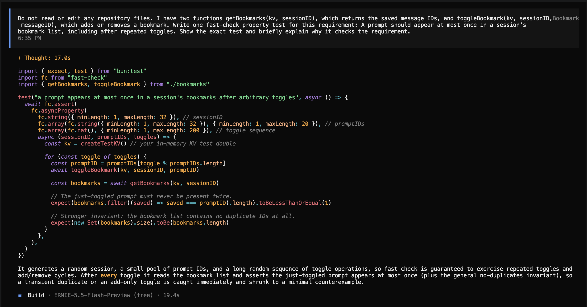

# Traceability: Thomas Cherian (tcherian)

**Target feature:** Prompt bookmarks in the OpenCode TUI. Users can bookmark prompts, look through saved prompts with /bookmarks, and add or remove bookmarks through /timeline.

**Files or modules that implement it:**

- packages/tui/src/routes/session/bookmarks.ts: stores, retrieves, filters, and toggles session bookmarks.
- packages/tui/src/routes/session/dialog-bookmarks.tsx: implements the searchable /bookmarks.
- packages/tui/src/routes/session/dialog-timeline.tsx: displays and toggles bookmark state in /timeline.
- packages/tui/src/routes/session/index.tsx: registers the command, renders the prompt bookmark control, and goes to the selected prompts.
- packages/tui/src/context/session-history.ts and packages/tui/src/context/sync.tsx: loads and merges older bookmarked prompts.

## Requirements

| ID | Interview evidence | Requirement | Acceptance Criteria | Changed in P4? | Property (kind) | Test | Mutants it kills |
| --- | --- | --- | --- | --- | --- | --- | --- |
| R1 | C-11, S-7: Cindy and Zdenek both expected bookmarks to be ordered according to when they were added. | The ordering in /bookmarks should be based on when they are added rather than the original order of prompts in the conversation. | Bookmark newer prompt "A" first, then bookmark older prompt "B". /bookmarks displays A before B because A was bookmarked first. | No | Model / oracle: generated results preserve bookmark-addition order, including when a saved message has not been loaded. | [`bookmarks.property.test.tsx`](../packages/tui/test/routes/session/bookmarks.property.test.tsx): R1: bookmarks follow bookmark-addition order and R1: missing messages are omitted without changing bookmark order | H1 and Stryker mutations that remove or replace the message lookup and result array. |
| R2 | C-8, S-3, O-3: All three interviewees expected bookmarking to leave the conversation text and order unchanged. | Adding or removing a bookmark should not modify message text, responses, message IDs, or message ordering. | Given a session with two prompts and their responses, record every message's ID, text, role, and position. Bookmark and unbookmark the first prompt. All recorded values and the message ordering remain identical. | No | Invariant: generated bookmark operations never modify generated conversation messages. | [`bookmarks.property.test.tsx`](../packages/tui/test/routes/session/bookmarks.property.test.tsx): R2: bookmark operations do not modify conversation messages | H2. |
| R3 | C-9, S-4: Bookmark changes should appear immediately in the prompt UI, /bookmarks, and /timeline. | Bookmark changes should appear immediately in the prompt UI, /bookmarks, and /timeline without needing to restart or reopen the session. | Bookmark prompt A and verify that its prompt shows "Bookmarked", /bookmarks contains A, and /timeline shows A as bookmarked. Remove it and verify that all three spots immediately show that it was removed without restarting the TUI. | No | Model / oracle and invariant: a toggle immediately returns the new state, while an unready store publishes no change. Existing component tests cover the rendered UI portion. | [`bookmarks.property.test.tsx`](../packages/tui/test/routes/session/bookmarks.property.test.tsx): R3: toggling before storage is ready leaves bookmark state unchanged and R3: toggle returns the updated bookmark state | Stryker mutations that disable the readiness guard, remove the toggle body, or return the old state. |
| R4 | S-5, O-5: Removing and adding the same bookmark should never create duplicate entries. | A prompt should appear at most once in a session's bookmark list. | Bookmark prompt A, remove its bookmark, and then bookmark it again. /bookmarks displays exactly one entry for A, and the message ID for A appears exactly once in stored bookmark data. | No | Invariant and model / oracle: generated toggle sequences never store duplicates, and persisted data normalizes to unique valid IDs. | [`bookmarks.property.test.tsx`](../packages/tui/test/routes/session/bookmarks.property.test.tsx): all three R4 properties | H3 after strengthening the assertion to inspect raw storage, plus Stryker mutations of array validation, filtering, deduplication, and empty-ID rejection. |
| R5 | C-10, S-6, O-6, O-8: Removing one bookmark should not affect any other bookmark. | Each prompt's bookmark state should be independent of every other prompt's bookmark state. | Bookmark prompts A and B, then remove the bookmark from A. A is no longer bookmarked, while B should still be bookmarked in the prompt UI, /bookmarks, and /timeline. | No | Metamorphic: toggling one generated bookmark changes only that prompt's state. | [`bookmarks.property.test.tsx`](../packages/tui/test/routes/session/bookmarks.property.test.tsx): R5: toggling one bookmark leaves all other bookmark states unchanged and R5: adding one bookmark leaves existing bookmarks unchanged | H4; H5 after adding the addition property. |

## AI Disclosure for Project 4

For Project 4, I used Codex to help classify my properties, create the outline for tcherian.md, and draft parts of the property tests. After the initial R1 failure, Codex also helped me locate and fix the ordering defect. I wrote the project-specific information and reviewed the generated tests and code changes against my interview requirements before keeping them.

## Requirement changes

I kept all five requirements. In Project 4 I initially selected R1, R2, R4, and R5 for property testing because their state behavior had deterministic acceptance criteria. During mutation testing I added two state-level R3 properties because Stryker showed that the storage-readiness guard and returned toggle state were otherwise untested; existing component tests still cover the rendered UI portion of R3.

## Run, triage, and fix

| Requirement | Initial result | Triage | Fix | Final result |
| --- | --- | --- | --- | --- |
| R1 | Initially failed. Fast-check reduced the failure to two messages whose bookmark-addition order was the reverse of their conversation order. | Implementation defect. bookmarkedMessages filtered the conversation in message order, and the dialog then reversed that result. The requirement remained valid. | Changed bookmarkedMessages to look up messages in stored bookmark-ID order, removed the dialog reversal, and updated the older order-dependent example tests. | Passed 100 generated cases. |
| R2 | Passed 100 generated conversations and toggle sequences. | No failure. | None. | Passed. |
| R3 | Not originally selected for property testing. | Stryker exposed survivors that disabled the storage-readiness guard or returned the previous bookmark state. | Added generated checks for toggles before storage is ready and for the state returned by both add and remove operations. | Passed and killed the related Stryker mutants. |
| R4 | Initially passed, but H3 survived because getBookmarks removed duplicates before the assertion observed them. | Weak oracle: the property checked normalized output instead of the raw stored state named by the acceptance criterion. | Changed the assertion to inspect the raw stored array and added generated malformed-storage properties. | Passed and killed H3 and the related Stryker survivors. |
| R5 | The removal property passed, but H5 survived because no property exercised addition while other bookmarks existed. | Generator gap: only the removal half of bookmark independence was generated. | Added a property that starts with existing bookmarks and adds a distinct generated ID. | Passed and killed H5. |

I ran bun test test/routes/session/bookmarks.property.test.tsx to check the properties, then ran the other focused bookmark suites. The three focused files passed 20 tests with 0 failures. Finally, bun typecheck passed and the complete TUI test suite passed 282 tests with 7 intentionally skipped and 0 failures.

## Hand-written mutants

I wrote these predictions before applying the mutants or running the property tests.

| ID | Requirement targeted | Change | Predicted killer | Actual result |
| --- | --- | --- | --- | --- |
| H1 | R1 | bookmarkedMessages shows the bookmarks in the order that the prompts appear in the conversation instead of the order the user bookmarked them. | The R1 ordering test should catch this whenever the user bookmarks the prompts in a different order from the conversation. | R1 caught it on the first generated test case. |
| H2 | R2 | bookmarkedMessages reverses the original conversation while finding the bookmarked messages. | The R2 test should catch this because it has a copy of the conversation and checks that bookmarking did not change it. | R2 caught it after four generated test cases. Fast-check simplified the failing case to two messages and one bookmark action. |
| H3 | R4 | Adding a bookmark saves the same message ID twice. | The R4 duplicate test should catch this after it adds a new bookmark. | It passed at first because getBookmarks got rid of the duplicate before the test checked the result. After I changed the test to inspect the stored data directly, R4 caught it. |
| H4 | R5 | Removing one bookmark accidentally removes every bookmark in the session. | The R5 independence test should catch this because every generated case starts with at least two bookmarks. After one is removed, the others should still be there. | R5 caught it on the first generated test case. Fast-check simplified the case to two starting bookmarks. |
| H5 | R5 | Adding a new bookmark accidentally replaces all the bookmarks that were already saved. | I predicted that the original R5 test would not catch this because it only tested removing a bookmark, not adding one. | It passed at first. I then added another R5 property that starts with saved bookmarks and adds a new one, and that property caught it. |

## Stryker comparison

I set fast-check's seed to 42 and ran Stryker with [`stryker.tcherian.config.json`](../packages/tui/stryker.tcherian.config.json). The configuration ran only bookmarks.property.test.tsx and mutated only lines 5–25 of src/routes/session/bookmarks.ts, which are the storage and ordering functions covered by these requirements.

On the first run, my tests caught 27 of the 37 bugs that Stryker created, giving me a score of 72.97%. The other ten bugs were not caught. For example, the tests did not notice when the code accepted bad saved data, ignored whether bookmark storage was ready, reported the wrong bookmark state, or returned a fake result for a missing message. I added better properties for R1, R3, R4, and R5 and ran Stryker again. This time, the tests caught all 37 of 37 mutants, so my score was 100%. None of the mutants were equivalent, meaning every code change affected the program's behavior, so the score with equivalent mutants removed is also 100%. The final HTML report is saved at [`mutants/tcherian/mutation.html`](../mutants/tcherian/mutation.html).

Stryker never generated H1, H2, H3, or H5. Those mutants reorder a collection, mutate an input array in place, append an ID twice, or discard existing IDs. Stryker changes existing expressions, operators, constants, and code blocks, but it does not usually invent these larger, feature specific changes. One Stryker mutation was similar to H4 because it removed code from the removal branch, but it did not generate the same complete bug.

I did not think of several small mutations that Stryker generated, such as accepting non-array saved data, accepting empty IDs, bypassing the kv.ready guard, returning saved instead of !saved, and inserting a fake result for a missing message. The return state mutations are mistakes a developer could realistically make. I think the hand-written mutants were better at finding realistic workflow and ordering mistakes, especially for the requirements created from the interviews. Stryker was better at systematically checking guards, constants, and return values that could be changed incorrectly.

## Agent failure case

I asked OpenCode to write an R4 property without reading or editing the repository. The /share command created https://opncd.ai/share/xXuwjMVI, but the page says that session sharing has been discontinued and does not show the conversation. Because this was not working, I included a screenshot of the conversation instead.

Asked AI to help me with adding the image


> My prompt: "I have two functions getBookmarks(kv, sessionID), which returns the saved message IDs, and toggleBookmark(kv, sessionID, messageID), which adds or removes a bookmark. Write one fast-check property test for this requirement: A prompt should appear at most once in a session's bookmark list, including after repeated toggles."
>
> OpenCode's proposed property:
>
> ```ts
> await toggleBookmark(kv, sessionID, promptID)
> const bookmarks = await getBookmarks(kv, sessionID)
> expect(bookmarks.filter((saved) => saved === promptID).length).toBeLessThanOrEqual(1)
> expect(new Set(bookmarks).size).toBe(bookmarks.length)
> ```
>
> OpenCode explained that checking after every generated toggle would catch a temporary duplicate or a toggle that only adds bookmarks.

To run the property, I used the same in-memory KV used by my other bookmark tests and corrected the import path, but did not change OpenCode's assertions. With H3 applied, OpenCode's property still passed with 1 test, 0 failures, and 1,160 assertions, so H3 survived. H3 stores a new message ID twice, but getBookmarks removes duplicates before returning the list. Since OpenCode checked the cleaned result, both of its assertions passed.

I improved the R4 property by checking kv.get("session_bookmarks:session") directly after every toggle. With H3 applied and the seed at 42, this version failed after the first generated case, and fast-check reduced the failure to one message ID. This killed H3 and showed that the original agent written property was checking the right idea at the wrong point.

## AI Disclosure for Project 5

The first thing I used AI for was the hand-written mutants table. Similar to the requirements table in the previous project, I asked Codex to create the format and then I went in and wrote the change, predicted killer, and actual result. Codex also helped review the patch files to make sure I did them right and helped me find good changes I could make for the patches themselves.

I also used AI to help me understand why some mutants survived with Stryker, and strengthen the properties that missed them. For the required Agent failure case, I asked OpenCode to generate an R4 property, then tested that property against H3.